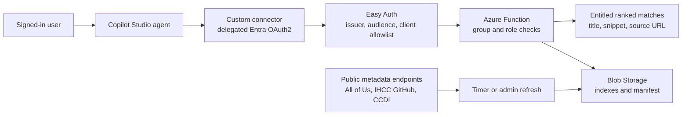
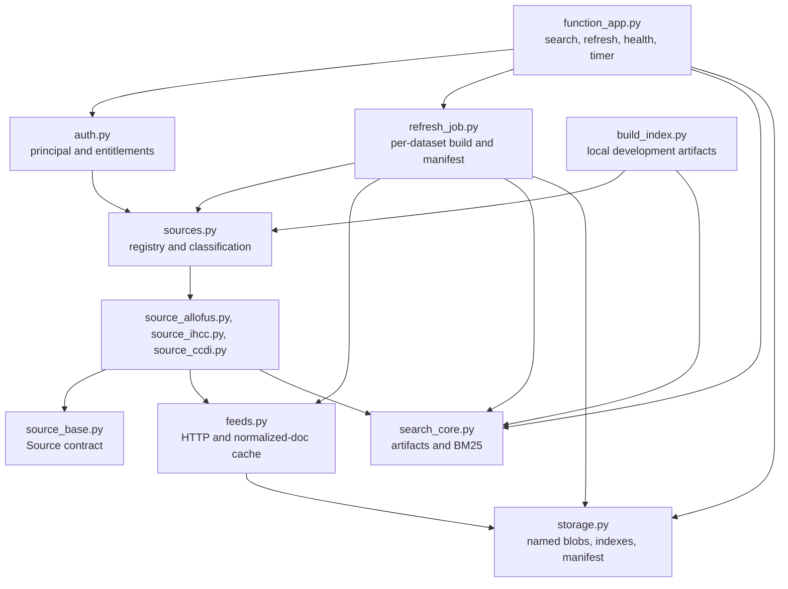
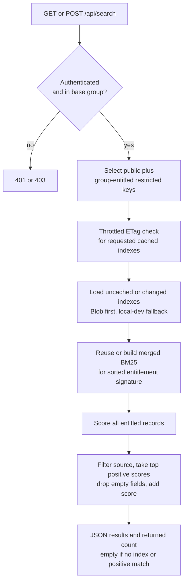
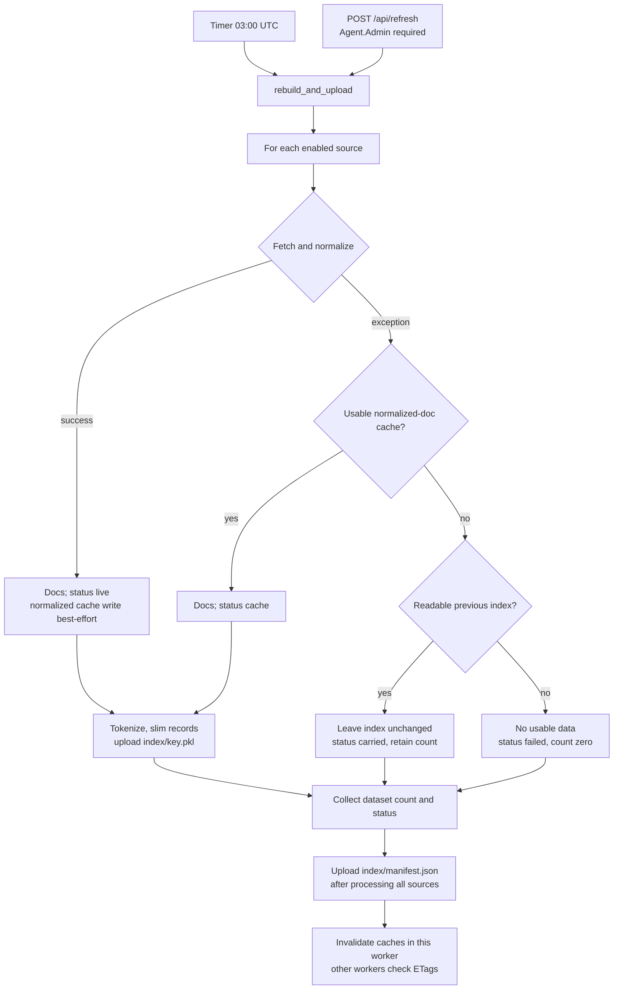
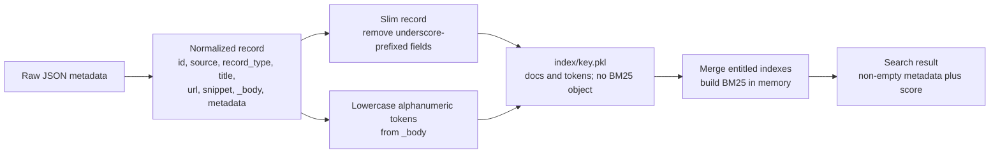

# Architecture - All of Us Research Finder

**As-built review: 2026-11-07, implementation commit `23f9658`.** This describes the
repository, not a verification of any live Azure or Power Platform deployment.

The Copilot Studio agent calls an Azure Functions Python v2 API that ranks similar
research with BM25. Four source families are ingested from public metadata
endpoints; their visibility in the application is a separate, configuration-driven
decision. The deployment makes publications/projects public to base-entitled
users, and IHCC/CCDI restricted to their respective groups.

| Dataset key | Manifest name | Ingestion source | Search unit |
|---|---|---|---|
| `publication` | Publication | `researchallofus.org/wp-json/rh-data-caching/publications-report` | Published paper |
| `project` | Project | `researchallofus.org/wp-json/rh-data-caching/projects` | Researcher Workbench project |
| `ihcc` | Cohort | `raw.githubusercontent.com/IHCC-cohorts/data-harmonization/master/data/cohort-data.json` | Health cohort |
| `ccdi` | Dataset | `federation.ccdi.cancer.gov/api/v1/{namespace,info,organization}` | Study/namespace metadata |

IHCC links to each cohort's website, falling back to the atlas homepage. CCDI links
to a node's about/documentation URL, falling back to the CCDI hub; these are not
necessarily individual study pages. CCDI does not ingest subject/sample/file data.
Record counts depend on upstream responses and should be read from the manifest,
not treated as fixed deployment targets.

The five diagrams below have matching `.mmd` sources and PNG exports in
[`diagrams/`](diagrams/). Render from that directory with
`mmdc -i <file>.mmd -o <file>.png -b white -s 2`.

## 1. End-to-end context

Search reads stored indexes; it does not call upstream sources. HTTP refresh
requires `Agent.Admin`; the daily in-process timer does not require an HTTP token.
`/api/health` is excluded from Easy Auth.

## 2. Module map (key dependencies)

`sources.ALL_SOURCES` registers two All of Us sources plus IHCC and CCDI. The
pipeline processes enabled sources in registry order. Adding a source requires a
`Source` implementation and registration; connector filter choices and agent
instructions also need updating.

## 3. Search request flow (two-level in-memory cache)

`AUTH_ENFORCED=false` bypasses the claims checks and selects all enabled sources;
this is the local-development mode, not the deployed default.

The caches in `function_app.py` are:

1. **Per-index**: dataset key -> documents, token lists, Blob ETag.
2. **Per-entitlement engine**: sorted dataset-key tuple -> merged documents, BM25
   model, and component ETags. Separate indexes are merged before scoring, because
   independently calculated BM25 scores are not comparable.

`CORPUS_CHECK_SECONDS` defaults to 300. Its timer is shared across a worker, but
each check examines only the keys in that request. This is **not** a guaranteed
five-minute freshness bound for every dataset: public-only traffic can consume
the check window while leaving a previously cached restricted index unchecked.
Caches are worker-local, not shared across instances.

The API accepts `query`, `directory` (or legacy `source`), and `top`. Defaults are
`directory=both` (equivalent to `all`) and `top=8`, clamped to 1-25. Plural aliases
`publications`/`projects` remain accepted; an unknown directory falls back to
`both`. Only positive-score matches are returned. The response has
`query`, `directory`, `count` (returned matches), and `results`; it does not expose
an overall corpus count.

## 4. Refresh flow (per-dataset resilience)

`feeds.fetch()` first tries `urllib` (three attempts by default, timeout 180s per
attempt), then one `httpx` HTTP/2-capable fallback. The fallback can also negotiate
HTTP/1.1; HTTP/2 is not guaranteed. If both paths fail, the original urllib error
is raised. CCDI uses one urllib attempt with a 200s timeout per endpoint, plus the
same fallback; `/namespace` is required, `/info` and `/organization` are enrichment
and may fail independently.

Normalized-doc caches are `<key>.docs.json` and retain `_body`. Search indexes
omit private fields and contain documents plus tokens. The default container is
`cache`; `CORPUS_CONTAINER`, `INDEX_PREFIX` (default `index/`), and `MANIFEST_BLOB`
(default `index/manifest.json`) can override storage locations. The `Source`
object's `index_blob` field is not used to route runtime storage calls.

**Limits of resilience:** a fetch/normalization exception triggers cache or index
carry-forward. A successful empty or partial response is instead rebuilt and
can reduce counts or replace an index with zero records. CCDI error nodes are
omitted; their old records are not merged into a partial successful response.
Index or manifest upload errors propagate. Writes are sequential, not an atomic
multi-dataset publication, and there is no refresh lock or durable job tracking.

`POST /api/refresh` runs synchronously. A completed all-live run returns
`status: refreshed`, `records`, per-dataset counts, `sources`, and `seconds`.
Non-live sources add `status: degraded` and `warnings` (still HTTP 200); a raised
exception returns HTTP 500. The timer logs exceptions without rethrowing them.
The roughly four-minute CCDI fetch observed during development can exceed
[Azure's 230-second HTTP response limit](https://learn.microsoft.com/en-us/azure/azure-functions/functions-scale#function-app-timeout-duration).
A longer client timeout cannot remove that limit. After a client timeout,
inspect execution logs and the manifest before retrying; the work may still be
running. The timer avoids the HTTP response limit.

## 5. Record lifecycle (data shape)

Artifacts use pickle protocol 4 and builtin Python data structures. They are
trusted internal artifacts, not a format for accepting user-supplied files.
`code/corpus.pkl` and its legacy blob helpers have been removed.
`code/.funcignore` excludes the entire `index/` directory: **no public or
restricted indexes ship with a deployment**. `build_index.py` writes local
development artifacts; `--public` filters according to the classification
available to that process, whose unconfigured defaults are all public.

## 6. Checked-in Power Platform export

`deployment/NIHAllofUs_1_0_0_2.zip` is a solution export (solution version
`1.0.0.2`) containing the agent, connector API version `2.0.0`, topics, actions,
and connection references. It is a separate snapshot, not generated by the
Azure deployment script or synchronized automatically with the loose Swagger.
It contains a concrete deployment host/identity configuration; rebind the
connector and connection references for a new environment.

The exported agent has two connector actions, `SearchDirectories` and
`GetHealth`, both using **Invoker** connection mode. The standalone Swagger uses
operation IDs `searchDirectories` and `getHealth`; preserve the correct action
bindings for whichever artifact is imported. Invoker mode supports the intended
end-user entitlement checks rather than a shared administrator connection.

The export's GPT metadata requests model **`GPT41`** and enables
`webBrowsing: true`; its Search topic contains a
`SearchAndSummarizeContent` fallback. The README's manual build instructions
instead select GPT5 Chat. These are different artifact configurations, not
verified runtime model selections in a tenant.

The exported instructions route IHCC/CCDI requests but still describe the search
tool as publications/projects only, label results only Publication/Project, and
give an incorrect expansion of IHCC. They also present health as a way to report
data freshness, though manifest timestamps do not represent last successful live
ingest. These are **remaining agent-export alignment gaps**. Web browsing and the
generative fallback mean the export is not structurally restricted to connector
results alone, despite its grounding instructions. This documentation update
does not modify or re-export that Power Platform solution.

## Health, observability, and review boundaries

`GET /api/health` returns `status: ok` plus the stored manifest's `total` and
`datasets`. Each entry has `key`, `name`, `classification`, `count`, source
`status`, and `updated_at`. This intentionally includes restricted dataset
metadata, not records. `updated_at` is the manifest-entry write time, even for
carried/failed sources, **not the timestamp of the last successful live ingest**.
Classification in health is a refresh snapshot; search uses current process
configuration, so refresh after classification changes to align the manifest.

Missing/unreadable manifests yield HTTP 200 with `status: ok`, `total: 0`, and
`datasets: []`. Health therefore does not currently enumerate all registered
datasets before the first refresh and is not a readiness, dependency-health, or
successful-refresh check. Storage read helpers also return missing-data values
for permission/network errors, so empty results alone cannot prove an empty
source.

The deploy script disables Application Insights and creates no Log Analytics
workspace, diagnostic settings, or alerts. `host.json` contains sampling
configuration, but this does not provision telemetry. The design in
[`../plans/observability-plan.md`](../plans/observability-plan.md) remains proposed.
See [`auth-design.md`](auth-design.md), [`security-hardening.md`](security-hardening.md),
and [`multi-cloud-deployment.md`](multi-cloud-deployment.md) for access controls,
deployment behavior, and known implementation gaps.
