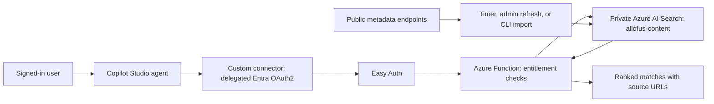
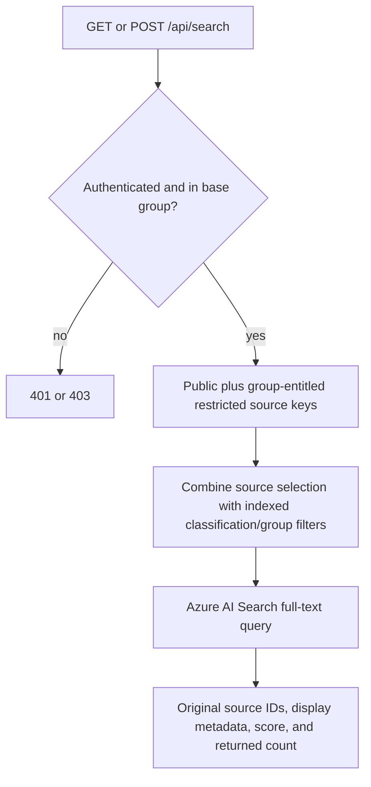
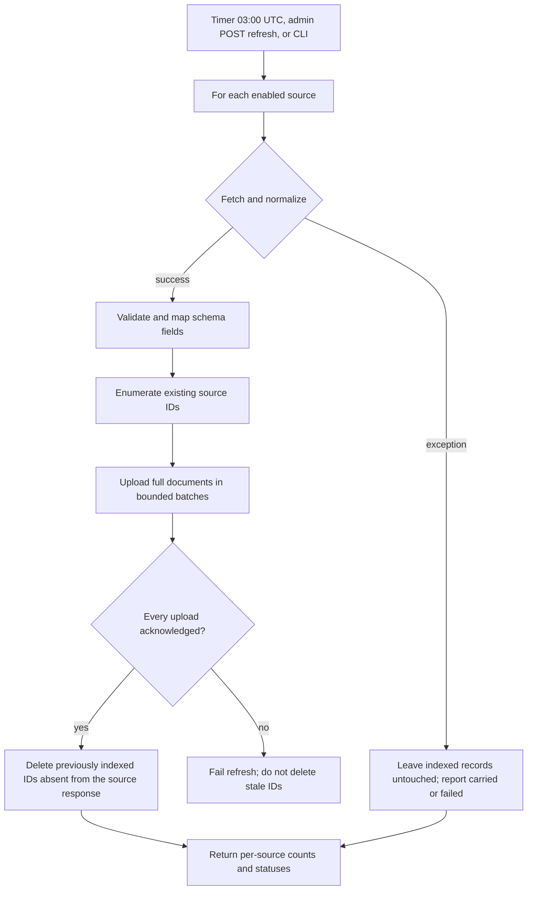

# Architecture - All of Us Research Finder

The Copilot Studio agent calls an Azure Functions Python v2 API that searches a
shared Azure AI Search index. Source metadata is imported by a daily timer,
admin-only HTTP refresh, or the command-line importer. This describes repository
behavior, not verification of a live deployment.

| Dataset key | Display name | Ingestion source | Search unit |
|---|---|---|---|
| `publication` | Publication | `researchallofus.org/wp-json/rh-data-caching/publications-report` | Published paper |
| `project` | Project | `researchallofus.org/wp-json/rh-data-caching/projects` | Researcher Workbench project |
| `ihcc` | Cohort | `raw.githubusercontent.com/IHCC-cohorts/data-harmonization/master/data/cohort-data.json` | Health cohort |
| `ccdi` | Dataset | `federation.ccdi.cancer.gov/api/v1/{namespace,info,organization}` | Study/namespace metadata |

IHCC links to each cohort's website, falling back to the atlas homepage. CCDI links
to a node's about/documentation URL, falling back to the CCDI hub; these are not
necessarily individual study pages. CCDI does not ingest subject/sample/file data.
Source counts depend on upstream responses.

## 1. End-to-end context

Search queries the index, not upstream APIs. The Function uses its managed identity
for Search; private networking, DNS, and Search data roles are required. The
storage account remains necessary for Azure Functions host/timer operations but
no longer holds application corpus caches, indexes, or a manifest.

The inline diagrams describe the Search implementation. Older files in
[`diagrams/`](diagrams/) are historical Blob/BM25 exports and are not current
architecture diagrams.

## 2. Module map

| Module | Responsibility |
|---|---|
| [function_app.py](../code/function_app.py) | Search, refresh, health, and daily timer interfaces |
| [auth.py](../code/auth.py) | Easy Auth principal parsing, base/dataset entitlements, admin role |
| [refresh_job.py](../code/refresh_job.py) | Per-source live import and failed-source carry-forward |
| [storage.py](../code/storage.py) | Shared Search client, schema mapping, batched writes/deletes, authorized queries, health counts |
| [feeds.py](../code/feeds.py) | Retrying JSON fetches and logged source failures; no corpus persistence |
| [sources.py](../code/sources.py) | Source registry and classification/group configuration |
| [source_base.py](../code/source_base.py) | Source contract |
| [source_allofus.py](../code/source_allofus.py), [source_ihcc.py](../code/source_ihcc.py), [source_ccdi.py](../code/source_ccdi.py) | Source fetching and normalization |
| [build_index.py](../code/build_index.py) | Command-line Search import; `--public` selects public sources |
| [search_core.py](../code/search_core.py) | Shared text helpers and legacy offline BM25/artifact utilities; no runtime corpus storage |

The pipeline processes enabled sources in registry order. Adding a source requires
a source implementation and registration; connector filter choices and agent
instructions also need updating.

## 3. Search request flow

The API retains `query`, `directory` (or legacy `source`), and `top`. Defaults are
`directory=both` (equivalent to `all`) and `top=8`, clamped to 1-25. Plural aliases
`publications`/`projects` remain accepted; an unknown directory falls back to
`both`. The response has `query`, `directory`, `count`, and `results`.

The server tokenizes the description into plain terms, requests any-term matching
with Search's simple full-text query, and filters before results are returned.
Ranking is now service-side; scores and ordering can differ from legacy BM25.
The API preserves original IDs, string citation counts, comma-separated institution
display values, and numeric scores. It does not expose indexed content or group
IDs. There are no per-index or per-entitlement corpus caches or ETag reloads.

`AUTH_ENFORCED=false` bypasses claims and indexed permission checks and selects
all enabled sources. This is a development bypass, not the deployed default.

## 4. Refresh flow (per-source resilience)

`feeds.fetch()` tries `urllib` (three attempts by default, timeout 180s per
attempt), then an HTTP/2-capable `httpx` fallback. CCDI uses one urllib attempt
with a 200s timeout per endpoint, plus the same fallback; `/namespace` is required,
while `/info` and `/organization` enrich metadata and can fail independently.

All schema and size validation occurs before document writes for that source.
Stable, source-qualified encoded keys make repeated imports idempotent.
Uploads replace complete documents, clearing removed optional values. Batches
contain at most 1,000 documents and 15 MiB of estimated JSON payload. Every
upload/delete acknowledgement is checked. Stale IDs are removed only after all
upload batches succeed.

A fetch/normalization exception retains the source's indexed records, reporting
`carried` if its count is positive and `failed` otherwise. Successful empty or
partial responses are authoritative and can remove records, including missing
CCDI nodes. Writes are sequential, not an atomic dataset publication. Partial
upload/delete failures can leave mixed data and require another refresh.
Run only one refresh at a time; no distributed refresh lock is implemented.
Index changes and query counts are eventually consistent.

`POST /api/refresh` remains synchronous. An all-live completion returns
`status: refreshed`, `records`, per-source `datasets`/`sources`, and `seconds`.
Unavailable sources add `status: degraded` and `warnings` (HTTP 200); indexing
or validation errors return HTTP 500. The timer logs exceptions.
Slow CCDI requests can exceed
[Azure's HTTP response timeout](https://learn.microsoft.com/azure/azure-functions/functions-scale#function-app-timeout-duration).
Inspect execution logs before retrying a timed-out request.

## 5. Record lifecycle and configuration

Raw metadata is normalized with the existing source contract, then mapped to the
25 fields in [index.json](../index.json). `_body` becomes persistent `content`;
`_institutions` preserves collection boundaries while the API retains display
strings. Integer fields are converted and missing values become `null`; missing
collections become `[]`. Source configuration supplies security metadata, never
upstream record values.

The deployment supplies `AZURE_SEARCH_ENDPOINT`, `AZURE_SEARCH_INDEX_NAME`, cloud
`AZURE_SEARCH_AUDIENCE`, and `AZURE_AUTHORITY_HOST`. Authentication uses
`DefaultAzureCredential`. [Search Index Structure](search-index.md) documents the
field tables, configuration, import algorithm, and permission filters.

No pickle files, normalized-data cache blobs, or manifest files are read or
written by the runtime. Old Blob data is left untouched, not automatically
migrated or deleted. `build_index.py` now imports directly into Search; an ordinary
Python invocation does not load `local.settings.json` automatically. Its
`--public` option uses that process's classification configuration.

## 6. Checked-in Power Platform export

`deployment/NIHAllofUs_1_0_0_2.zip` is a separate solution snapshot, not generated
by deployment or synchronized automatically with the loose Swagger. Rebind its
connector and connection references for a new environment.

Its `SearchDirectories` and `GetHealth` actions use **Invoker** connection mode;
the standalone Swagger uses operation IDs `searchDirectories` and `getHealth`.
Preserve the correct bindings for the imported artifact.

The export requests `GPT41`, enables web browsing, and includes a generative
Search fallback; the README's manual instructions select GPT5 Chat. Its stale
result-type and health-freshness instructions need alignment with the four-source
API. This change does not re-export the solution or structurally restrict it to
connector-grounded responses.

## Health, observability, and boundaries

`GET /api/health` queries every enabled source in Search and returns `status: ok`,
`total`, and `datasets`. Each entry includes name, current configured classification,
count, `status` (`indexed` or `empty`), and `updated_at` (latest document ingestion
time, or `null` for empty sources). This intentionally exposes restricted dataset
metadata, not records. It does not persist refresh outcomes or probe upstream
availability. Failed Search requests return HTTP 503 rather than empty success.

The deploy script disables Application Insights and creates no Log Analytics
workspace, diagnostic settings, or alerts. The
[observability plan](../plans/observability-plan.md) remains proposed. See
[authorization](auth-design.md), [security controls](security-hardening.md), and
[deployment](multi-cloud-deployment.md) for remaining implementation gaps.
