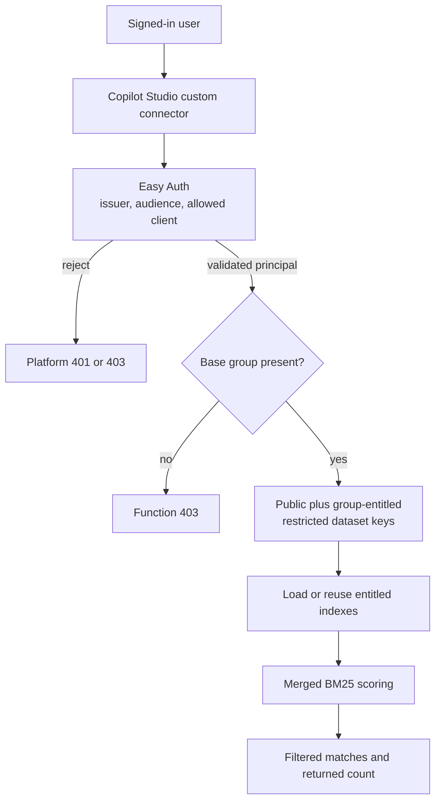

# Authentication and Authorization (as-built)

**Reviewed: 2026-11-07, implementation commit `23f9658`.** This is the access model
implemented in the repository. It does not certify a live deployment or imply
that every production-hardening requirement is complete.

## 1. Access model

Access is delegated and per user. The Function reads the identity validated by
App Service Authentication ("Easy Auth"), then maps group and app-role claims to
permissions. In the deployed configuration:

- `publication` and `project` are **public to base-entitled agent users**, not
  anonymously accessible.
- `ihcc` and `ccdi` are independent **restricted compartments**, each requiring
  its own group in addition to the base entitlement for search.
- HTTP refresh requires the `Agent.Admin` app role, **not** the base group.
- Health is intentionally anonymous and reveals dataset metadata, not records.

## 2. Entra objects provisioned by the deployment

`deployment/deploy_azure_infrastructure.ps1` creates:

| Object | Configuration and purpose |
|---|---|
| API application `AllOfUs-Function-API` | Identifier URI `api://<API-APP-ID>`; `api.requestedAccessTokenVersion=2`; enabled delegated `access_as_user` scope with user/admin consent text |
| API app role `Agent.Access` | Enabled, `allowedMemberTypes: ["User"]` (users/groups); used to assign the three entitlement groups to the API enterprise application without making them administrators |
| API app role `Agent.Admin` | Enabled, `allowedMemberTypes: ["User"]`; assigned separately to refresh administrators |
| API enterprise application | Service principal created after the API manifest is configured; holds user/group app-role assignments |
| Client application `AllOfUs-Function-Client` | Connector client registration plus a client secret; callback/redirect URI and consent setup remain operator work |
| `AoU-Agent-Users` | Base search entitlement group |
| `AoU-DS-IHCC`, `AoU-DS-CCDI` | Independent restricted-dataset entitlement groups |

The script looks up each group by name before creating it and rejects unresolved
group IDs before writing app settings. App registrations are still created anew
on each run; the overall script is **not idempotent**.

The three groups are assigned to **`Agent.Access`**, not an all-zero "Default
Access" role and never `Agent.Admin`. `auth.py` does not check `Agent.Access`
itself: group membership drives search authorization. This role assignment
allows the groups to appear in the API's filtered group claims.

## 3. Easy Auth platform gate

The script sends a JSON file with `Content-Type: application/json` to ARM
`config/authsettingsV2` (API version `2022-03-01`). It sets:

| Property | Value |
|---|---|
| `platform.enabled` | `true` |
| `globalValidation.requireAuthentication` | `true` |
| `globalValidation.unauthenticatedClientAction` | `Return401` |
| `globalValidation.excludedPaths` | `["/api/health"]` |
| Entra `registration.clientId` | API application ID |
| Entra `registration.openIdIssuer` | `<cloud authority>/<tenant ID>/v2.0` |
| Entra `validation.allowedAudiences` | Both `api://<API-APP-ID>` and the bare API application ID (v2 access-token audience) |
| `validation.defaultAuthorizationPolicy.allowedApplications` | Connector client application ID and Azure CLI ID `04b07795-8ddb-461a-bbee-02f9e1bf7b46` |
| `login.tokenStore.enabled` | `true` |

Allowlisting a client **does not grant OAuth consent**; scope pre-authorization is
a separate manual step. Easy Auth can reject requests before the Function runs,
so HTTP 403 alone is not proof of a missing app-role claim.

All Function HTTP routes are `ANONYMOUS` at the Functions authorization layer.
There is no function-key authorization requirement. Easy Auth must remain
enabled in a deployed environment; the Python code relies on its injected
`X-MS-CLIENT-PRINCIPAL` header rather than independently validating a JWT.

## 4. Group and role claims

The API manifest sets `groupMembershipClaims: "ApplicationGroup"`. By default,
assigned group **object IDs** are emitted as `groups`; role **values**
(`Agent.Access`, `Agent.Admin`) are emitted as `roles`. `auth.py` recognizes the
short claim names and their common URI variants, plus the caller's object ID.
It makes no Microsoft Graph membership lookup.

Operators must add test users directly to the relevant groups and separately
grant administrators `Agent.Admin`. Merely assigning a group to the enterprise
application does not put a user in that group. Filtered application-group claims
do not expand nested group membership; tenant licensing for group-based app
assignment must also be confirmed.

**Do not select "Emit groups as role claims" (`emit_as_roles`).** That moves group
IDs into `roles` and suppresses assigned app-role values, breaking both the base
group check and `Agent.Admin` check. If a token has GUIDs in `roles` but no
`groups`, inspect the API's group optional-claims configuration, role definitions,
assignments, and token age. Do not infer from that symptom alone that a service
principal is stale, or delete/recreate it as the default recovery; deletion
removes assignments and can disrupt consent.

See Microsoft's [optional-claims reference](https://learn.microsoft.com/en-us/entra/identity-platform/optional-claims#configure-groups-optional-claims)
and [group-claims caveats](https://learn.microsoft.com/en-us/entra/identity/hybrid/connect/how-to-connect-fed-group-claims).
After changing assignments, obtain a new access token for this API and recreate
the HTTP authorization header; Azure CLI can return cached tokens.

## 5. Function authorization rules

| Endpoint | Rule when `AUTH_ENFORCED=true` |
|---|---|
| `GET/POST /api/search` | For a valid query, require a parsed principal (401 otherwise) and `BASE_ENTITLEMENT_GROUP_ID` in its groups (403 otherwise). Select public datasets plus restricted datasets mapped to held group IDs. Load/merge those indexes only. `count` is the number of returned matches. |
| `POST /api/refresh` | Require a parsed principal and the literal `ADMIN_ROLE` value in roles (default `Agent.Admin`); missing principal -> 401, missing role -> 403. No base or dataset group is required to rebuild all enabled datasets. |
| `GET /api/health` | No claims check. Return the stored manifest, including restricted names/counts/statuses. Missing/unreadable manifest -> HTTP 200, `status: ok`, zero total and an empty dataset list. |
| `refresh_timer` | In-process daily trigger at 03:00 UTC; no HTTP identity required. |

The code checks groups/roles, but does not separately enforce an OAuth `scp`
value or an app-only/delegated token type. The deployed registration and client
allowlist are part of the intended delegated path.

## 6. Configuration source of truth

`DATASET_CLASSIFICATION` is an app-setting **JSON string**, read by
`sources.apply_classification()` at module import. The greenfield script writes:

```json
{
  "ihcc": {
    "classification": "restricted",
    "entitlement_group_id": "<AoU-DS-IHCC object ID>"
  },
  "ccdi": {
    "classification": "restricted",
    "entitlement_group_id": "<AoU-DS-CCDI object ID>"
  }
}
```

`publication` and `project` are omitted and use the `Source` default `public`.
Changing classification/group IDs requires an app-settings update and process
restart, plus any necessary Entra assignments, **not a code redeploy**. A refresh
updates the manifest's classification snapshot; health does not recompute it.

The script writes this setting using `--settings @<JSON-file>` to preserve nested
quotes through Windows Azure CLI argument handling. Verify the persisted JSON
and that restricted entries contain the intended group object IDs.

**Important implementation limitation:** absent configuration leaves all source
defaults public; invalid JSON logs a warning and is ignored. Classification
values, map shape, and group-ID uniqueness are not strictly validated. The
claims checks fail closed for a missing base group or role, but classification
configuration as a whole is **not fail-closed**. A restricted entry without a
usable group cannot be entitled; an omitted restricted entry defaults public.

`index_blob` is not a supported override in this JSON map.
`Source.index_blob` has a default value, but runtime index helpers derive paths
from `INDEX_PREFIX` instead. See [`architecture.md`](architecture.md).

## 7. Authorized search flow

Exports: [PNG](diagrams/auth-search-flow.png) and
[Mermaid source](diagrams/auth-search-flow.mmd).



An unentitled request does not trigger loading its restricted index. An index
loaded by an entitled user can remain in that worker's cache; the guarantee is
request-specific engine selection, not purging all restricted bytes from memory.
Refresh workers intentionally ingest all enabled sources.

## 8. Connector and operator setup

The current Swagger 2.0 spec (`custom_connector/openapi-swagger.yaml`, version
`2.0.0`) exposes **GET search** (`searchDirectories`) and **GET health**
(`getHealth`). It does not expose POST search or refresh. Global delegated OAuth
security is inherited by both operations: the API health route is anonymous,
but the connector spec does not override OAuth for its health operation.

After infrastructure deployment:

1. Pre-authorize the connector client for the API's `access_as_user` scope, and
   Azure CLI if using it for API tests. The deploy manifest does not set
   `preAuthorizedApplications`.
2. Assign users to the base/dataset groups and refresh administrators to
   `Agent.Admin`; verify a new API access token contains the expected claims.
3. Publish Function code. Packages contain no indexes; run refresh or await the
   timer, and check source statuses/counts rather than health `status` alone.
4. Import the connector with the deployed host, tenant, and API identifiers.
   Configure its client ID and secret. For a resource field use
   `api://<API-APP-ID>`; for a v2 scope field use
   `api://<API-APP-ID>/access_as_user`. These are distinct values.
5. Copy the connector's generated OAuth redirect URL into the client app's **Web
   redirect URIs** before creating the connection. The script does not configure
   redirect URIs. Test with the end user's delegated connection, not a shared
   administrator connection.

   The checked-in Power Platform ZIP also contains search/health actions in
   **Invoker** mode, with capitalized operation IDs. It is a separate environment
   snapshot; see [the export inventory](architecture.md#6-checked-in-power-platform-export)
   before substituting it for the standalone Swagger/manual agent build.

   The default app roles allow `User`, not `Application`; external app-only
schedulers are **not provisioned or supported by this deployment**. The internal
timer is the unattended refresh mechanism. Adding machine callers would require
an explicit role/client/authorization design change.

See [`../readme.md`](../readme.md) for the operator runbook and
[`multi-cloud-deployment.md`](multi-cloud-deployment.md) for cloud-specific gaps.
`AUTH_ENFORCED` defaults false in code and is false in local settings; the deploy
script sets true. Tests construct principal headers directly, so they validate
Python authorization, not live Entra token issuance or Easy Auth configuration.
